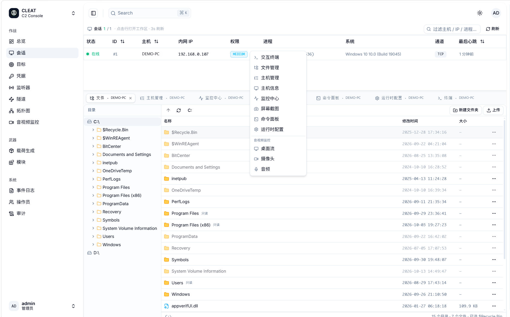
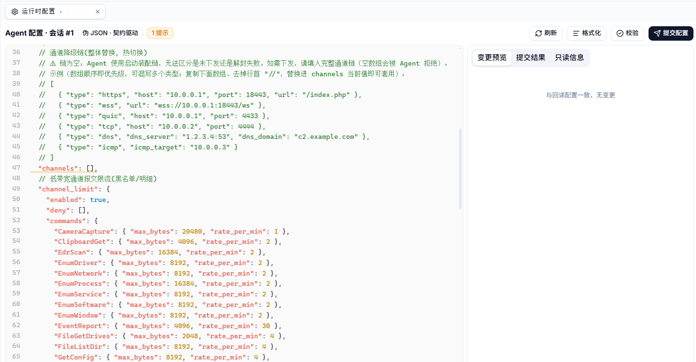

<div align="center">


[](https://github.com/coldpon/Cleat/commits/main)
[](LICENSE)


[](https://github.com/coldpon/Cleat/stargazers)
[](https://github.com/coldpon/Cleat/issues)
[](https://github.com/coldpon/Cleat/commits/main)

[简体中文](README.md) | **English**

</div>

## Highlights

### Data plane · Hybrid frames

`JSON header + 0x00 + binary body`. The frame boundary is guaranteed by the JSON
spec (the first raw zero byte can only be the separator); relays route by header
alone; binary payloads carry zero encoding overhead.

### Control plane · Runtime channel chain

Six transports — HTTPS / TCP / DNS (incl. DoH, RFC 8484) / ICMP / WebSocket /
QUIC (optional) — with priority-ordered failover, probing and anti-flap.
Re-chained remotely via `SetConfig`: atomic, no restart.

### Time plane · Conditional sleep mask

The whole image dwells encrypted while idle on low-frequency channels; a
multithread park protocol plus fail-closed census, with six hard
build-configuration rules (each born from a real crash).

**Also:**

- **Session/transport decoupling** — all six transports expose the same frame byte stream; fragmentation, crypto and throttling stay inside the transport
- **Module system** — capabilities ship as modules, loaded/unloaded at runtime; core and module command planes are separate
- **Pivot relay** — multi-hop relays only parse frame headers to route
- **Engineering discipline** — single source of truth for config, unique registration points, fail-closed on malformed input, no homegrown crypto

Full architecture and design principles: [docs/ARCHITECTURE.md](docs/ARCHITECTURE.md).

## Screenshots



> Operator console: sessions, file browsing, modular capability entry points (demo environment; host details sanitized; the UI shows the full capability set while this repo ships the core edition)



> Runtime channel configuration: edit visually, validate, push remotely — re-chaining without restarts

## Quick start (Windows)

```cmd
:: 1) Dependency (one-time; official libsodium prebuilt package, no compiler needed)
scripts\build_libsodium.cmd

:: 2) Configure + build (x64 Release)
cmake -S Agent -B Agent/build -G "Visual Studio 17 2022" -A x64
cmake --build Agent/build --config Release --parallel
```

Other components: `cd TeamServer && go build ./cmd/teamserver`; web console build
instructions live in `cleat-web/`. Optional QUIC channel, vcpkg dependency mode
and troubleshooting: see [docs/BUILD.md](docs/BUILD.md).

## Repository layout

```
Agent/        C++ implant (Core: comms / mask / tasking; Components: pivot / shell / file transfer...)
TeamServer/   Go server
cleat-web/    Operator console
scripts/      Dependency build scripts (libsodium / msquic)
docs/         Documentation (architecture / build)
```

## Documentation

| Document | Content |
| --- | --- |
| [ARCHITECTURE.md](docs/ARCHITECTURE.md) | Architecture overview and principles |
| [BUILD.md](docs/BUILD.md) | Build guide and troubleshooting |

## Project status and maintenance cadence

**This is a work-in-progress engineering project, not an out-of-the-box operational tool.**

- It started as a personal spare-time project and was not designed for production delivery; there is still a long way to go before it can be used in real operations
- The agent is relatively complete; the team server, web console and surrounding capabilities are still being fleshed out — evaluate all gaps yourself
- Issues and PRs are read carefully, but responses may be slow (spare-time maintenance; days to weeks is normal)
- No roadmap or release cadence is promised; merges are gated on "not breaking existing invariants"
- Evaluate thoroughly before use in production or critical environments

## Credits

Third-party components, design inspirations and implementation references:
see [CREDITS.md](CREDITS.md).

## Legal

This tool is designed for **AUTHORIZED security testing and red team
operations ONLY**. Unauthorized use is strictly prohibited and may violate
local and international laws. Use at your own risk. No support or promises are
provided regarding detection evasion.

## License

[MIT](LICENSE)
